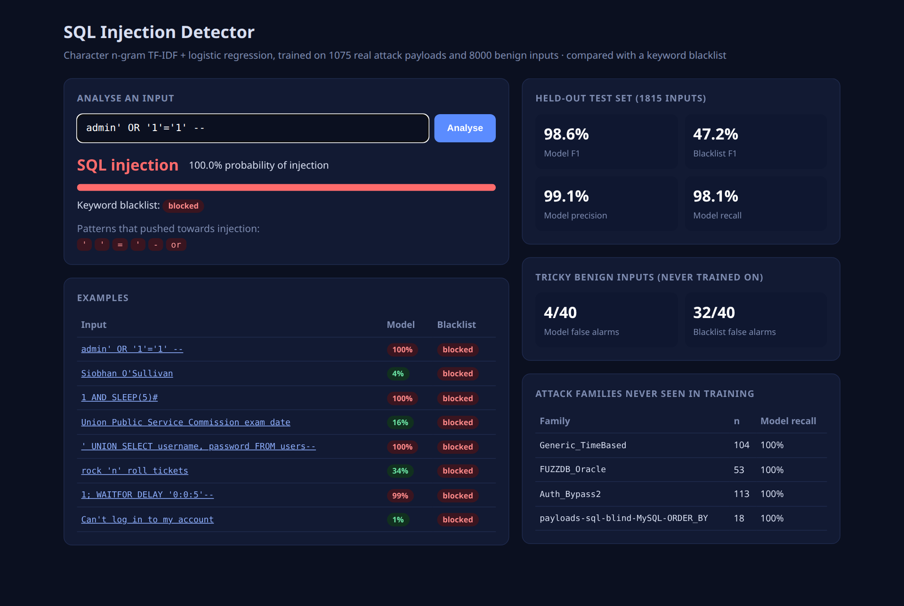

# SQL Injection Detector

A machine-learning detector for SQL injection in user input, compared with the keyword
blacklist many applications still rely on. It includes a web demo that explains each
decision.



## Results

Trained on **1,075 real attack payloads** (21 lists from
[PayloadsAllTheThings](https://github.com/swisskyrepo/PayloadsAllTheThings), MIT licence)
and **8,000 benign inputs**: generated form input (names, emails, searches, addresses)
plus short fragments of public-domain books from Project Gutenberg.

| Test | ML model | Keyword blacklist |
|---|---|---|
| Held-out test set (1,815 inputs): F1 | **98.6%** | 47.2% |
| Precision / recall | 99.1% / 98.1% | 31.9% / 90.7% |
| 40 tricky benign inputs never trained on ("Siobhan O'Sullivan", "Union Public Service Commission"): false alarms | **4 / 40** | 32 / 40 |
| Attack families left out of training (time-based, Oracle, auth bypass, ORDER BY blind): recall | **100%** on all four | 96–100% |

The full numbers are in [`data/metrics.json`](data/metrics.json).

**Lesson learned:** with only template-generated benign data, the first model flagged
38 of the 40 tricky benign inputs. It had learned "unlike my templates = attack".
Adding real prose, full of apostrophes, quotes and the words "or", "and" and "select",
brought that down to 4.

## How it works

- `sqli/dataset.py`: downloads the payload lists and books, deduplicates the payloads,
  caps each list at 150 so no list dominates, and records each payload's family.
- `sqli/model.py`: TF-IDF over character n-grams (1–5) with class-balanced logistic
  regression. Character n-grams catch SQL syntax (`' or`, `--`, `union`, `sleep(`)
  through spacing and casing tricks, and the linear model makes every decision
  explainable through n-gram weights. The module also holds the blacklist baseline and
  the evaluation: a stratified split, leave-one-family-out, and the hard negatives.
- `app.py`: Flask demo showing the probability, the blacklist's verdict, and the patterns
  that drove the decision.

## Run it

```sh
python -m venv .venv && .venv/bin/pip install -r requirements.txt
.venv/bin/python -m sqli train     # build data/dataset.csv, evaluate, save the model
.venv/bin/python app.py            # http://localhost:5050
.venv/bin/python -m pytest
```

A detector like this is a second layer only. The real fix for SQL injection is
parameterised queries.
